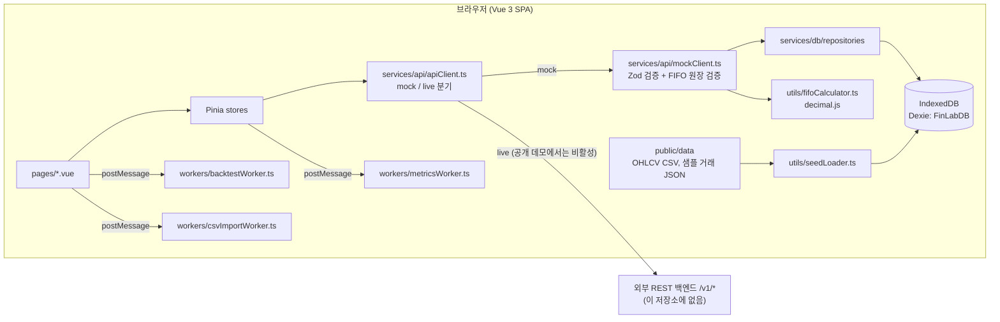

# FinLab

> 2024년 샘플 시세와 가상 거래로 FIFO 원가, 보유 종목, 리스크 지표, 분할 매수 대 일시불 백테스트를 브라우저 안에서 계산해 보는 포트폴리오 시뮬레이터.

**Live demo:** https://financial-lab-six.vercel.app/dashboard (실시간 시세·실제 주문 없음, 데이터는 방문자 브라우저의 IndexedDB에만 저장)


## 해결하는 문제

FIFO 원가 계산, 샤프 비율, 적립식(DCA) 대 일시불 비교는 개념은 단순하지만 직접 숫자를 넣어 보기 어렵습니다. FinLab은 서버나 계정 없이 브라우저만으로 샘플 포트폴리오(AAPL·SPY, 거래 10건)를 열고, 거래를 추가·삭제하거나 CSV로 가져와 결과가 어떻게 바뀌는지 확인하게 합니다. 공개 데모는 실시간 시세와 실제 주문을 쓰지 않습니다.

## 아키텍처



자세한 구성과 실패 처리는 [docs/architecture.md](docs/architecture.md), 결정 기록은 [docs/adr/](docs/adr/)에 있습니다.

## 핵심 기술 결정

- **API 계약 뒤의 브라우저 내 mock 백엔드** — 모든 화면은 `ApiClientInterface`만 호출하고, `configStore.backendMode`에 따라 `MockApiClient`(IndexedDB) 또는 `fetch` 기반 live 요청으로 갈립니다. live 응답도 같은 Zod 스키마로 검증합니다. 공개 빌드는 `VITE_DEMO_ONLY=true`로 mock을 강제합니다. (`frontend/src/services/api/apiClient.ts`, `frontend/src/stores/configStore.ts`, [ADR 0001](docs/adr/0001-mock-backend-behind-api-contract.md))
- **저장 전에 FIFO 원장 검증** — 보유 수량을 넘는 매도, 이후 매도가 의존하는 매수의 삭제는 저장 전에 거부합니다. 잘못된 원장이 한 번 저장되면 이후 보유·지표 계산이 계속 실패하기 때문입니다. 금액 계산은 `decimal.js`로 합니다. (`frontend/src/services/api/mockClient.ts`의 `findLedgerError`, `frontend/src/utils/fifoCalculator.ts`, [ADR 0002](docs/adr/0002-validate-fifo-ledger-before-write.md))
- **방문자 데이터를 지우지 않는 멱등 샘플 시딩** — 실제 IndexedDB 행을 기준으로 빠진 샘플만 채우고, 기존 포트폴리오와 분리된 이름의 샘플 포트폴리오를 씁니다. 시딩은 Dexie 트랜잭션 안에서 실행해 탭이 여러 개여도 중복되지 않습니다. (`frontend/src/utils/seedLoader.ts`, [ADR 0003](docs/adr/0003-idempotent-non-destructive-demo-seeding.md))
- **계산은 Web Worker에서** — DCA/일시불 백테스트, 변동성·샤프·최대 낙폭, CSV 파싱을 각각 별도 워커에서 실행해 UI 스레드를 막지 않습니다. (`frontend/src/workers/`)
- **브라우저 보안 헤더** — Vercel 응답에 CSP(`connect-src`를 self와 Vercel로 제한), `X-Frame-Options: DENY`, `nosniff`를 붙입니다. CSP 때문에 공개 데모에서는 외부 live 백엔드 호출이 막히므로 mock 전용 모드와 짝을 이룹니다. (`vercel.json`)

## 로컬 실행

Node 20 이상 (CI는 Node 20, 아래 결과는 Node 22.19.0에서 확인).

```bash
cd frontend
npm ci              # 의존성 설치
npm test -- --run   # Vitest 1회 실행 (happy-dom + fake-indexeddb)
npm run build       # vue-tsc -b 타입 검사 후 vite build
npm run dev         # 개발 서버 http://localhost:5173 (이번 점검에서는 실행하지 않음)
```

공개 데모와 같은 mock 전용 빌드는 `VITE_DEMO_ONLY=true npm run build`입니다 (`vercel.json`의 buildCommand).

## 테스트

| 항목 | 결과 |
|------|------|
| 명령 | `cd frontend && npm test -- --run` |
| 날짜 | 2026-10-28 |
| 결과 | 테스트 파일 13개, 테스트 96개 통과 / 0 실패 / 0 건너뜀 |
| 타입 검사 | `npm run build` (`vue-tsc -b`) 통과 |

테스트 대상: FIFO 계산기, mock API의 원장 검증, 샘플 시딩, CSV 가져오기, 거래 필터, 자산 곡선, 날짜 입력, 백테스트 워커, 지표 워커, 설정 스토어, 다국어 문구와 라우트 문구. CI(`.github/workflows/ci.yml`)는 PR과 `main` push마다 `npm ci`, `npm run build`, `npm test -- --run`을 실행합니다.

## 한계와 다음 단계

- **백엔드 코드가 없습니다.** live 모드는 `/v1/*` REST 계약(Zod 스키마, `frontend/public/docs/openapi.json`)으로 외부 서버를 부르도록 되어 있지만, 그 서버(PRD에 적힌 Spring Boot 구현)는 이 저장소에 없습니다. 기존 `docs/` 문서와 `PRD.md`의 백엔드 설명은 계획입니다.
- **DCA 주기는 캔들 개수 기준입니다.** `backtestWorker.ts`는 `WEEKLY`를 7개 캔들, `MONTHLY`를 30개 캔들마다 매수합니다. 거래일 기준이므로 실제 달력 주·월보다 깁니다.
- **샤프 비율 단위가 섞여 있습니다.** 일별 수익률은 퍼센트(예: `1` = 1%)인데 무위험 수익률은 소수(`0.02`)를 252로 나눠 그대로 뺍니다. 결과적으로 무위험 수익률이 의도보다 100배 작게 반영됩니다 (`metricsWorker.ts`, `mockClient.ts`).
- **샘플 시세는 2024-01-02 ~ 2024-04-01** (AAPL, SPY, MSFT, QQQ, NVDA 종목별 약 62일치)뿐입니다.
- 지표 계산이 `workers/metricsWorker.ts`와 `services/api/mockClient.ts`에 중복되어 있고, `composables/useBacktest.ts`는 현재 어느 화면에서도 쓰이지 않습니다.
- FIFO 원가에 거래 수수료(`fee`)는 반영되지 않습니다.

## 문서

| 문서 | 내용 |
|------|------|
| [docs/architecture.md](docs/architecture.md) | 구성 요소, 데이터 흐름, 실패 처리 |
| [docs/adr/](docs/adr/) | 아키텍처 결정 기록 |
| [docs/USER-GUIDE.md](docs/USER-GUIDE.md) | 화면별 사용법 |
| [docs/DEVELOPER-GUIDE.md](docs/DEVELOPER-GUIDE.md) | 코드 구조 (백엔드 부분은 계획) |
| [docs/API-DOCUMENTATION.md](docs/API-DOCUMENTATION.md) | `/v1/*` API 계약 |
| [PRD.md](PRD.md) | 초기 제품 요구사항 |

## 라이선스

이전 README에 MIT로 표기되어 있었으나 저장소에 `LICENSE` 파일은 아직 없습니다.

## 사용한 오픈소스

Vue, Vite, Pinia, Dexie.js, Chart.js, Zod, decimal.js, PapaParse, vue-i18n.
