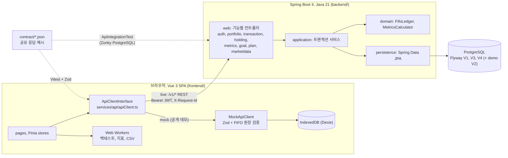

# FinLab

> 가상 거래로 FIFO 원가, 보유 종목, 리스크 지표, 분할 매수 대 일시불 백테스트를 계산하는 포트폴리오 시뮬레이터. Vue 3 SPA와 Spring Boot + PostgreSQL 백엔드가 같은 `/v1/*` 계약을 공유합니다.

**Live demo:** https://financial-lab-six.vercel.app/dashboard

> 공개 데모는 **브라우저 안의 mock 백엔드**(IndexedDB)로만 동작합니다. Spring Boot 백엔드는 공개 호스팅되지 않으며, 아래 [전체 스택 실행](#전체-스택-로컬-실행)으로 로컬에서 띄워 연결합니다. 실시간 시세·실제 주문은 없습니다.


## 해결하는 문제

FIFO 원가, 샤프 비율, 적립식(DCA) 대 일시불 비교는 개념은 단순하지만 직접 숫자를 넣어 보기 어렵습니다. FinLab은 샘플 포트폴리오(AAPL·SPY, 거래 10건)에서 거래를 추가·삭제하거나 CSV로 가져와 결과가 어떻게 바뀌는지 보여 줍니다. 서버 쪽에서는 동시에 들어온 매도 두 건이 같은 주식을 이중으로 팔지 못하게 원장 불변식을 PostgreSQL 잠금으로 지키는 것이 핵심 문제입니다.

## 아키텍처



화면과 스토어는 `ApiClientInterface`만 호출합니다. `configStore.backendMode`가 `mock`이면 브라우저 안의 `MockApiClient`가, `live`이면 `fetch`로 Spring Boot 백엔드가 응답하고, 두 경우 모두 같은 Zod 스키마로 응답을 검증합니다. 백엔드는 기능 패키지마다 `web → application → domain/persistence` 계층을 두고 ArchUnit으로 의존 방향을 검사합니다.

자세한 내용은 [docs/architecture.md](docs/architecture.md), 결정 기록은 [docs/adr/](docs/adr/README.md)에 있습니다.

## 핵심 기술 결정

- **포트폴리오 행 비관적 잠금 + 원장 전체 FIFO 재생** — 거래 생성·삭제는 한 DB 트랜잭션에서 소유 포트폴리오를 `PESSIMISTIC_WRITE`(`SELECT … FOR UPDATE`)로 잠그고, 후보 원장 전체를 시간·ID 순으로 재생한 뒤 커밋합니다. 초과 매도나 이후 매도가 의존하는 매수의 삭제는 422, 잠금 대기 3000 ms 초과는 409입니다. 낙관적 잠금만으로는 행 삽입이 포트폴리오 버전을 바꾸지 않아 이 불변식을 지킬 수 없습니다. (`backend/src/main/java/io/github/cskwork/finlab/transaction/application/TransactionService.java`, `portfolio/persistence/PortfolioLockingRepositoryImpl.java`, `transaction/domain/FifoLedger.java`, [backend ADR 0001](backend/docs/adr/0001-ledger-consistency.md))
- **멱등성 키** — 거래 생성은 선택적 `Idempotency-Key`를 받아 포트폴리오 범위로 저장하고, 요청 본문의 SHA-256 지문과 묶습니다. 같은 잠금 안에서 확인하므로 같은 키의 동시 요청도 한 번만 삽입되고, 같은 요청은 저장된 응답을 그대로 재생, 다른 본문은 422입니다. TTL 24시간, 1시간마다 만료 행 삭제. (`transaction/application/TransactionService.java`, `transaction/domain/IdempotencyPolicy.java`, `transaction/application/IdempotencyPurge.java`)
- **RS256 JWT 리소스 서버 + 로그인 제한기** — 로그인은 bcrypt(cost 12)로 검증하고 15분짜리 RS256 토큰을 발급합니다. 나머지 `/v1/*`는 Spring Security OAuth2 리소스 서버가 서명·issuer·audience·만료를 검증하고, 소유권은 토큰 subject로만 판단합니다(남의 리소스는 404). 로그인은 IP 20회·이메일 10회 토큰 버킷(1분 리필)과 bcrypt 동시 실행 2개 세마포어로 막습니다(429/503 + `Retry-After`). (`auth/security/SecurityConfiguration.java`, `auth/application/AuthService.java`, `auth/application/LoginAttemptLimiter.java`, [backend ADR 0002](backend/docs/adr/0002-auth-contract.md))
- **양쪽이 함께 검사하는 계약 예시** — `contract/*.json` 18개를 프론트엔드는 Zod 스키마로(`frontend/src/services/api/contract.spec.ts`), 백엔드는 실제 HTTP 응답과 비교해(`ApiIntegrationTest.java`) 검사합니다. 통합 테스트가 저장한 실제 응답 18개를 CI가 다시 프론트엔드 Zod 스펙에 통과시킵니다. 오류는 RFC 9457 `ProblemDetail`에 `code`·`message`·`details`를 더한 형식이고, 프론트엔드 `readProblem()`이 `application/problem+json`을 `ApiErrorSchema`로 파싱합니다. ([contract/README.md](contract/README.md), `.github/workflows/ci.yml`, [backend ADR 0003](backend/docs/adr/0003-contract-verification.md))
- **Docker 없이 실제 PostgreSQL로 테스트** — 통합 테스트는 Zonky embedded PostgreSQL(바이너리 14.22)을 직접 띄워 Flyway 마이그레이션, 행 잠금, 동시 매도 경합을 검증합니다. H2나 Testcontainers는 쓰지 않습니다. ArchUnit 8개 규칙이 계층 의존을, JaCoCo가 application·domain 패키지별 라인 커버리지 80% 이상을 `mvn verify`에서 강제합니다. (`backend/pom.xml`, `backend/src/test/java/io/github/cskwork/finlab/integration/ApiIntegrationTest.java`, `architecture/LayeringTest.java`)

프론트엔드 쪽 결정(API 계약 뒤 mock, 저장 전 FIFO 원장 검증, 방문자 데이터를 지우지 않는 시딩)은 [docs/adr/0001](docs/adr/0001-mock-backend-behind-api-contract.md)–[0003](docs/adr/0003-idempotent-non-destructive-demo-seeding.md)에 있습니다. 위 경로에서 `transaction/…`, `auth/…`처럼 시작하는 것은 `backend/src/main/java/io/github/cskwork/finlab/` 아래입니다.

## 실행

### 데모 (프론트엔드만, mock)

Node 20.x는 20.19 이상, 또는 22.12 이상 (Vite 7의 `engines` 기준).

```bash
cd frontend
npm ci
npm run dev          # http://localhost:5173, 기본 mock 모드
npm test -- --run    # Vitest 1회 실행
npm run build        # vue-tsc 타입 검사 + vite build
```

공개 데모와 같은 mock 전용 빌드는 `VITE_DEMO_ONLY=true npm run build`입니다(`vercel.json`의 buildCommand). 이 빌드는 저장된 live 설정을 무시하고, CSP `connect-src`가 외부 백엔드를 막습니다.

### 전체 스택 로컬 실행

필요한 것: Java 21, PostgreSQL(Docker 불필요), Node. 백엔드는 데이터베이스를 직접 띄우지 않습니다.

1. **PostgreSQL** — 기존 서버에 `finlab` 사용자와 DB를 만들거나, Homebrew PostgreSQL로 일회용 클러스터를 띄웁니다(루프백 전용, trust 인증, 로컬 테스트용).

   ```bash
   pg_data=$(mktemp -d)
   initdb -D "$pg_data" -U finlab --auth-local=trust --auth-host=trust
   pg_ctl -D "$pg_data" -l "$pg_data/server.log" -o "-h 127.0.0.1 -p 55432" start
   createdb -h 127.0.0.1 -p 55432 -U finlab finlab
   ```

2. **백엔드 (`local` 프로필)** — Flyway가 스키마, 샘플 시세, 데모 계정을 만들고, 서명 키가 없으면 임시 RSA 키를 생성합니다(재시작하면 토큰 무효).

   ```bash
   cd backend
   DB_URL=jdbc:postgresql://127.0.0.1:55432/finlab DB_USERNAME=finlab \
     SPRING_PROFILES_ACTIVE=local ./mvnw -B spring-boot:run   # http://localhost:8080
   ```

   Swagger UI: `http://localhost:8080/swagger-ui.html`, 헬스: `/actuator/health`.

3. **프론트엔드 live 모드** — `cd frontend && VITE_DEMO_ONLY=false npm run dev`로 띄운 뒤, 랜딩 화면이나 상단 설정에서 **Live**를 고르고 백엔드 URL 기본값 `http://localhost:8080`을 사용합니다. 데모 계정 `demo@finlab.app` / `FinLabDemo!2026`으로 로그인합니다. 이 계정은 `db/demo/V2__seed_demo_user.sql`에 있고 `local`·`demo`·`test` 프로필에서만 적용되는 공개 데모용 값입니다.

4. **HTTP 스모크(선택)** — `FINLAB_URL=http://localhost:8080 bash backend/scripts/smoke.sh` (curl, Python 3 필요).

설정 값, 운영용 키 생성, 프로필 설명은 [backend/README.md](backend/README.md)에 있습니다.

## 테스트

2026-10-28 기준, 모두 통과 / 0 실패 / 0 건너뜀.

| 대상 | 명령 | 결과 |
|------|------|------|
| 백엔드 | `cd backend && ./mvnw -B clean verify` | **225 통과** (Surefire XML 34개) |
| 백엔드 커버리지 | JaCoCo (`backend/target/site/jacoco/`) | 전체 라인 **98.87%** (790/799), 분기 89.85% (301/335); application+domain 라인 **99.59%** (485/487) |
| 프론트엔드 | `cd frontend && npm test -- --run` | **183 통과**, 테스트 파일 17개 |
| 계약 (실제 응답) | `FINLAB_CONTRACT_ACTUAL_DIR=../backend/target/contract-actual npm test -- --run src/services/api/contract.spec.ts` | **38 통과** (예시 18 + 실제 응답 18 + 누락 검사 2) |

백엔드 225개의 계층별 내역:

| 계층 | 테스트 | 내용 |
|------|------:|------|
| domain | 47 | FIFO 원장, 지표 계산, 엔티티 규칙 |
| application | 101 | 서비스 실패 경로, 멱등성, 로그인 제한 |
| web | 26 | MVC 슬라이스(검증, ProblemDetail, 보안), 응답 매핑 |
| integration | 21 | 실제 PostgreSQL: Flyway, 로그인, CRUD, 동시 매도, 멱등 재생·만료 |
| common/security | 13 | 요청 ID, 예외 처리기, JWT 설정 |
| architecture | 8 | ArchUnit 계층·순환 규칙 |
| persistence | 6 | SQL 필터 |
| config | 3 | `FinLabProperties`, JWT 속성 검증 |

출처: 백엔드 수치는 [backend/docs/verification-2026-10-28.md](backend/docs/verification-2026-10-28.md)와 `backend/target/surefire-reports`, `backend/target/site/jacoco/index.html`, 프론트엔드 183개는 2026-10-28 `npm test -- --run` 직접 실행 결과입니다. Docker/Testcontainers로 돌리는 테스트는 0개입니다. 실행 중인 서버에 대한 HTTP 스모크 기록은 [backend/docs/smoke-2026-10-28.txt](backend/docs/smoke-2026-10-28.txt)에 있습니다.

CI(`.github/workflows/ci.yml`)는 PR과 `main` push마다 프론트엔드 빌드·테스트와 백엔드 `verify` + 실제 응답 계약 검사를 실행합니다. 백엔드 CI 잡은 아직 GitHub에서 실행된 적이 없습니다(로컬에서만 확인).

## 한계

- **공개 데모는 mock 전용**이고 백엔드는 어디에도 배포되어 있지 않습니다.
- **샘플 시세만** 있습니다: 2024-01-02 ~ 2024-04-01, AAPL·MSFT·NVDA·QQQ·SPY 5종 번들 CSV(`frontend/public/data/ohlcv/`, 백엔드는 같은 데이터를 `V3__seed_sample_market_data.sql`로 적재).
- **인증**: 리프레시 토큰, 토큰 폐기, 회원 가입, 비밀번호 찾기가 없습니다. 프론트엔드는 토큰을 `localStorage`에 보관합니다.
- **로그인 제한기는 프로세스 로컬**입니다. 인스턴스가 여러 개면 공유 저장소나 엣지 제한이 필요합니다. 프록시 뒤에서는 피어 IP 하나를 방문자들이 함께 쓰게 됩니다(`forward-headers-strategy: none`).
- **Vue 클라이언트는 `Idempotency-Key`를 보내지 않습니다.** 멱등성은 curl·스모크 같은 API 호출자만 씁니다.
- 한 포트폴리오의 쓰기는 직렬화되고, 쓰기마다 원장 전체를 재생합니다(원장 길이에 선형). 거래 목록은 최신순 기본 1000행 상한이며 `X-Total-Count`로 전체 일치 행 수를 알립니다. 커서는 없습니다.
- 지표는 mock과 같은 의미를 유지합니다: 현재 시가 가중치, 현금 0, `pnlYTD`는 올해가 아니라 전체 샘플 기간 복리입니다.
- 백테스트는 live 모드에서도 브라우저 워커가 IndexedDB 샘플 캔들로 계산하며, 수수료·슬리피지를 모델링하지 않습니다.

## 문서

| 문서 | 내용 |
|------|------|
| [docs/architecture.md](docs/architecture.md) | 두 모드, 백엔드 계층·트랜잭션·보안·관측성·설정 |
| [docs/adr/](docs/adr/README.md) | 결정 기록 (프론트엔드 0001–0003, 백엔드 0001–0003) |
| [backend/README.md](backend/README.md) | 백엔드 실행, 설정, 운영 |
| [backend/docs/architecture.md](backend/docs/architecture.md) | 백엔드 상세 설계 |
| [contract/README.md](contract/README.md) | 공유 HTTP 예시와 엔드포인트 표 |
| [docs/USER-GUIDE.md](docs/USER-GUIDE.md) | 화면별 사용법 |
| [docs/planned/](docs/README.md#과거-계획-자료) | 백엔드 구현 전 계획 문서 (대체됨) |
| [PRD.md](PRD.md) | 초기 제품 요구사항 |

## 라이선스

MIT. [LICENSE](LICENSE)를 참고하세요.

## 사용한 오픈소스

프론트엔드: Vue, Vite, Pinia, Dexie.js, Chart.js, Zod, decimal.js, PapaParse, vue-i18n.
백엔드: Spring Boot, Spring Security (OAuth2 Resource Server), Spring Data JPA, Flyway, PostgreSQL JDBC, springdoc-openapi, Zonky embedded PostgreSQL, ArchUnit, JaCoCo.
