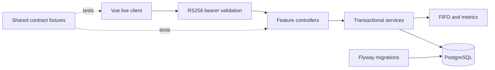

# FinLab backend

A Java 21 / Spring Boot service for the existing Vue `/v1/*` API: an owned portfolio ledger, FIFO holdings,
market-data-based metrics, savings goals, and recurring investment plans. The service persists to PostgreSQL.
It is not hosted publicly: the public static demo uses only the in-browser mock, and this service runs locally.
Project overview (Korean): [top-level README](../README.md); both modes: [docs/architecture.md](../docs/architecture.md).

The main correctness problem is concurrent ledger edits. Two individually valid sells must not spend the same
shares. Each transaction mutation locks its portfolio and replays the complete FIFO ledger before committing.
Shared JSON fixtures connect real backend responses to the frontend's Zod schemas.



## Decisions and code

- [TransactionService](src/main/java/io/github/cskwork/finlab/transaction/application/TransactionService.java)
  serializes writes through an owned portfolio row lock. Replay also rejects deletion of a buy needed by a later
  sell. This favors a simple correctness boundary over parallel writes within one portfolio.
- [FifoLedger](src/main/java/io/github/cskwork/finlab/transaction/domain/FifoLedger.java) uses `BigDecimal` and
  includes buy fees in lot cost and sell fees in net proceeds. Metrics preserve the existing frontend calculation,
  including its limitations, rather than introducing a second definition of portfolio performance.
- [SecurityConfiguration](src/main/java/io/github/cskwork/finlab/auth/security/SecurityConfiguration.java) configures
  a stateless OAuth2 resource server; [AuthService](src/main/java/io/github/cskwork/finlab/auth/application/AuthService.java)
  verifies a delegated bcrypt hash and issues an RS256 access token. The frontend login sends a transient password;
  no password is stored in browser state, storage, or logs.
- [Migrations](src/main/resources/db/migration/) own the schema and sample data. JPA validates it with
  `open-in-view=false`; application services define transaction boundaries. The mutable portfolio has `@Version`;
  goals and plans expose create/read/delete operations and do not carry unused update versions.
- [Contract fixtures](../contract/) are checked by backend integration tests and
  [frontend Zod tests](../frontend/src/services/api/contract.spec.ts). Deletes return HTTP 200 with JSON because
  the existing client always reads a JSON body.

See [architecture](docs/architecture.md), [ledger ADR](docs/adr/0001-ledger-consistency.md),
[authentication ADR](docs/adr/0002-auth-contract.md), and [contract ADR](docs/adr/0003-contract-verification.md).
The root [docs/architecture.md](../docs/architecture.md) covers the frontend, both modes and this service together;
[docs/adr/](../docs/adr/README.md) indexes the frontend and backend ADRs.

## Run locally

Requires Java 21 and PostgreSQL. The Maven Wrapper pins Maven **3.9.16**. Dependencies are pinned to Spring Boot
**4.1.2**, springdoc **3.2.0**, Zonky embedded PostgreSQL **2.2.2** (tests), ArchUnit **1.5.1**, and JaCoCo **0.8.14**.
The Spring Boot BOM manages Hibernate, Flyway, the PostgreSQL JDBC driver, Jackson, and JUnit.
Tests use Zonky directly, so the optional `embedded-database-spring-test` adapter is unnecessary.

The `local` profile expects `jdbc:postgresql://localhost:5432/finlab`, user `finlab`, and an empty password unless
overridden. It does not start PostgreSQL. Set `DB_URL`, `DB_USERNAME`, and `DB_PASSWORD` for your database, then:

```sh
cd backend
SPRING_PROFILES_ACTIVE=local ./mvnw -B spring-boot:run
```

`JAVA_HOME` must point to Java 21. On hosts where `~/.m2` is read-only, set `MAVEN_USER_HOME` (Wrapper
distribution cache) and `-Dmaven.repo.local=<dir>` to a writable directory; the dated verification record shows
the exact paths used on the verification machine. The app defaults to port
**8080** (`PORT` overrides it).

For a disposable Homebrew PostgreSQL cluster without Docker, choose an unused port, such as **55432**:

```sh
finlab_pg_data=$(mktemp -d)
finlab_pg_port=55432
/opt/homebrew/bin/initdb -D "$finlab_pg_data" -U finlab --auth-local=trust --auth-host=trust
/opt/homebrew/bin/pg_ctl -D "$finlab_pg_data" -l "$finlab_pg_data/server.log" \
  -o "-h 127.0.0.1 -p $finlab_pg_port" start
/opt/homebrew/bin/createdb -h 127.0.0.1 -p "$finlab_pg_port" -U finlab finlab
DB_URL="jdbc:postgresql://127.0.0.1:$finlab_pg_port/finlab" DB_USERNAME=finlab \
  SPRING_PROFILES_ACTIVE=local ./mvnw -B spring-boot:run
```

This cluster uses trust authentication and binds only to loopback; it is solely for disposable local testing.
After stopping the app with Ctrl-C, stop that cluster with
`/opt/homebrew/bin/pg_ctl -D "$finlab_pg_data" -m fast stop`. Keep its data directory until any evidence you need
has been collected.

The Flyway demo account is **`demo@finlab.app` / `FinLabDemo!2026`**. These are deliberately public demo
credentials, not a production secret. Its bcrypt hash lives in `db/demo/V2__seed_demo_user.sql`, included only
by the `local`, `demo`, and `test` profiles. The base/production migration location creates no account.
Do not enable those profiles on a production database; production account provisioning is outside this API.

For the local Vue client, run `VITE_DEMO_ONLY=false npm run dev` from `frontend/`, select **Live** on the landing
page or in the navigation settings, and use the default backend URL `http://localhost:8080`. Log in with email and password. The backend
CORS default allows `http://localhost:5173`; set `CORS_ALLOWED_ORIGINS` for another frontend origin. The existing
public `VITE_DEMO_ONLY=true` build remains mock-only, with its static-site CSP unchanged.

## Configuration and operations

All defaults are in [application.yml](src/main/resources/application.yml). Important overrides:

- Database: `DB_URL`, `DB_USERNAME`, `DB_PASSWORD`, `DB_POOL_SIZE` (default **10**).
- HTTP: `PORT` (default **8080**), `CORS_ALLOWED_ORIGINS` (comma-separated allowlist).
- JWT: `FINLAB_JWT_ISSUER` (`finlab`), `FINLAB_JWT_AUDIENCE` (`finlab-api`), `FINLAB_JWT_TTL` (**15m**;
  must be positive and at most **1h**), `FINLAB_JWT_PRIVATE_KEY_LOCATION`, and `FINLAB_JWT_PUBLIC_KEY_LOCATION`.
- Login: `FINLAB_LOGIN_HASHING_PERMITS` (**2**), `FINLAB_LOGIN_HASHING_WAIT` (**500ms**, positive and at most **5s**), `FINLAB_LOGIN_IP_CAPACITY` (**20**),
  `FINLAB_LOGIN_EMAIL_CAPACITY` (**10**), `FINLAB_LOGIN_REFILL_PERIOD` (**1m**), and
  `FINLAB_LOGIN_MAX_TRACKED_KEYS` (**10000**). Capacity is a token-bucket burst allowance; tokens refill
  continuously over that period. Limits and tracked-key memory are per process.

[FinLabProperties](src/main/java/io/github/cskwork/finlab/config/FinLabProperties.java) validates CORS, login,
idempotency, and ledger limits at startup. Idempotency TTL defaults to **24h** and scheduled purge delay to
**1h**. Portfolio lock timeout defaults to **3000 ms** and the filtered transaction list to **1000 rows**.
Override properties such as `finlab.idempotency.purge-interval` or `finlab.ledger.transaction-list-limit`
through standard Spring configuration, command-line arguments, or `SPRING_APPLICATION_JSON`.

Services use the shared UTC `Clock`; tests can fix time without adding time dependencies to pure domain logic.
Public monetary numbers round to **4 decimal places**, quantity and average cost to **8**, with `HALF_UP` and
plain decimal JSON output. Internal calculations keep full precision. Structured RFC 9457 errors preserve
field errors, framework HTTP status/headers, and request IDs; an invalid plan date range identifies `endDate`.

In `local` and `test`, missing signing keys generate an ephemeral RSA pair; restarting invalidates those tokens.
Other profiles, including an explicitly selected `demo` profile, require both key resources. Production expects a matching RSA pair of at least
**2048 bits**, with a PKCS#8 private PEM and X.509 public PEM. Generate and mount keys outside the repository:

```sh
umask 077
finlab_key_dir="$HOME/.config/finlab/keys"
mkdir -p "$finlab_key_dir"
openssl genpkey -algorithm RSA -pkeyopt rsa_keygen_bits:3072 -out "$finlab_key_dir/private.pem"
openssl pkey -in "$finlab_key_dir/private.pem" -pubout -out "$finlab_key_dir/public.pem"
export FINLAB_JWT_PRIVATE_KEY_LOCATION="file:$finlab_key_dir/private.pem"
export FINLAB_JWT_PUBLIC_KEY_LOCATION="file:$finlab_key_dir/public.pem"
```

Mount key files read-only in production, keep private material outside version control, supply production DB
credentials through the environment, and terminate HTTPS at the serving infrastructure. Do not enable `local`
or `test` profiles in production.

Key locations are Spring resource locations, not inline key text; Spring Security's `RsaKeyConverters` reads
the PEM resources. OpenAPI is served at `/v3/api-docs`; Swagger UI at `/swagger-ui.html` with an HTTP bearer
authorization scheme. Only Swagger paths allow inline styles and data images in their CSP; the API retains
the stricter policy. Actuator exposes only `/actuator/health`
and `/actuator/info`. Console logs use Spring Boot's ECS JSON format. `X-Request-Id` is validated or generated,
returned to the caller, and attached to MDC for correlation. Virtual threads are enabled; graceful shutdown
allows **30 seconds** per shutdown phase.

## Verification

```sh
cd backend
./mvnw -B verify
cd ../frontend
npm test -- --run
npm run build
```

`verify` runs domain/application unit tests, MVC slices, ArchUnit rules, and Spring Boot integration tests backed
by actual Zonky PostgreSQL binaries. No Docker or Testcontainers are used. JaCoCo requires **at least 80% line
coverage in each application and domain package**. Real HTTP smoke commands are in
[scripts/smoke.sh](scripts/smoke.sh); run them against the disposable local app with
`FINLAB_URL=http://localhost:8080 bash scripts/smoke.sh`. The script redacts the login token and verifies
oversell rejection and identical idempotent replay.

On 2026-10-28 `clean verify` passed **225** tests (0 failures, errors or skipped) with **99.59%** line coverage of the
application and domain packages (485/487); the frontend passed **183** tests. Exact commands, per-layer counts and
coverage are in [the dated verification record](docs/verification-2026-10-28.md).
The HTTP transcript is [smoke-2026-10-28.txt](docs/smoke-2026-10-28.txt). The backend CI job additionally runs
the frontend contract spec against captured real response bodies in `target/contract-actual/`; failure reports
are uploaded from `target/surefire-reports/`.

Zonky defaults to PostgreSQL **14.22**. The automatically activated Apple Silicon Maven profile adds its native
`darwin-arm64v8` binary artifact; Linux CI uses the default Linux x64 binaries. The smoke script and CSV migration
generator require Python 3; the HTTP smoke also uses curl.

## Limits

Market prices are bundled samples, not a live feed. Holdings use the latest stored close, or FIFO cost when
history is absent. Metrics match the mock: latest market-value weights over sampled daily returns, cash fixed
at **0**, and no cash-flow-adjusted performance calculation. The `pnlYTD` field compounds all available sampled
returns; it does not select the current calendar year.

Authentication has no refresh tokens, token revocation, registration, or password recovery. The frontend keeps
the bearer token in browser storage and clears the session on a protected-call **401**. Login rate buckets
and the hash semaphore are process-local, so multiple replicas require shared or edge abuse controls. The IP
bucket uses the connection's peer address; forwarded headers are disabled by default. A reverse proxy can
therefore share an IP allowance across visitors until its trusted address policy is configured deliberately.

Transaction list responses apply SQL filters and return the newest **1000** matches in descending timestamp/ID order by default, with the filtered total in `X-Total-Count` (exposed through CORS);
the array contract has no continuation cursor. FIFO validation and valuation still read the complete ledger.
Other collections remain unpaginated, and full-ledger replay costs grow with history. `ADMIN` is retained as
a contract-compatible role, with the same ownership checks; no admin account or administration workflow is seeded.

The Vue live client sends a UUID `Idempotency-Key` per transaction submit and retains it for retries of the same submit.
`scripts/smoke.sh` also verifies replay. Backtests are not a backend endpoint; the browser computes them from IndexedDB samples in
both modes. The backend CI job in `.github/workflows/ci.yml` has not yet run on GitHub.
