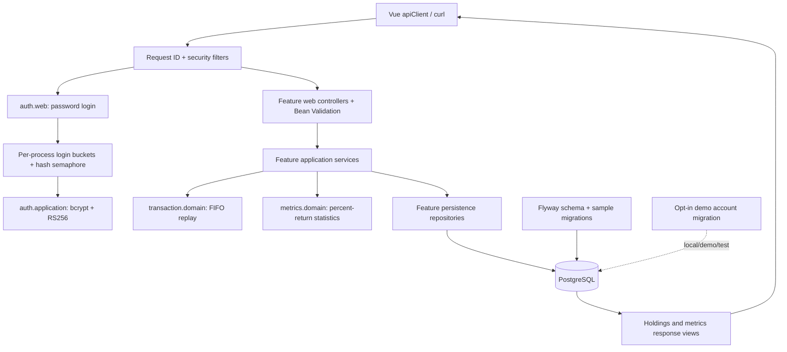

# Backend architecture

FinLab's Spring service implements the Vue live API using PostgreSQL persistence, pure FIFO/metrics logic, and
an RS256 bearer boundary. The static frontend mock remains available independently.

## Modules and dependency boundaries

The Java root is `src/main/java/io/github/cskwork/finlab/`:

- `auth`: account lookup, bounded password verification, RS256 resource-server configuration, token issuance,
  and login request/response records.
- `portfolio`: owned mutable aggregate, optimistic versioning, row-lock boundary, and CRUD operations.
- `goal`, `plan`: owned create/read/delete resources without an update API; plans validate their date range.
- `transaction`: immutable ledger entries, FIFO replay, portfolio-locked mutations, and idempotency records.
- `holding`, `metrics`: computed views of the owned ledger and sample price histories; they do not maintain
  separate persisted holdings or metrics snapshots.
- `marketdata`: read-only candle access and a batched history query for all held symbols.
- `common/error`, `common/web`: RFC 9457 problems, request IDs, HTTP number formatting, OpenAPI declarations,
  and the `@CurrentUserId` argument resolver. They do not depend on a feature application package.
- `config`: a shared UTC `Clock`, plain-decimal JSON output, and validated operational properties in
  `FinLabProperties`. JWT-specific properties stay under `auth/config`; security stays under `auth/security`.

Controllers call application services; services use repositories in their own feature and application APIs
of other features. Domain code does not depend on web, application, or persistence packages. JPA annotations
remain on the persistence-backed domain entities; the FIFO and metrics calculators are pure Java.
[LayeringTest](../src/test/java/io/github/cskwork/finlab/architecture/LayeringTest.java) enforces these boundaries
and checks portfolio optimistic versioning. Time-dependent services use the injectable `Clock`; domain
calculators have no Spring or clock dependency.

## Request and data flow

Login is `POST /v1/auth/login` with email and a transient password of at most **72 UTF-8 bytes**. Email lookup
trims and lowercases the address; a case-insensitive unique index prevents two differently cased accounts.
`LoginAttemptLimiter` checks token buckets for the connection's peer IP and normalized email, with default
capacities of **20** and **10**, refilling over **1 minute**. Its map is bounded to **10000 keys**. Exhausted
allowances return **429** with `Retry-After`; a full tracking map also refuses new keys rather than growing.

`AuthService` uses a nonblocking semaphore with **2** permits by default around account lookup and bcrypt
verification. Saturation returns **503** with `Retry-After: 1`. The repository's short read transaction ends
before bcrypt work, so hashing does not retain a database connection. Unknown accounts still perform a real
dummy hash check, and invalid credentials have one generic response. A successful check issues a short-lived
RS256 token. These controls are process-local, not distributed rate limits. Other `/v1/*` calls
require a validated token with a `USER` or `ADMIN` role. Ownership uses its numeric subject, not a client-supplied
user ID; controllers receive it through `@CurrentUserId` rather than parsing JWTs independently. Foreign and
missing portfolio resources return the same **404**. `ADMIN` is a permitted contract role, not a seeded
account or an implemented administration workflow, and does not bypass portfolio ownership.

For a transaction create or delete:

1. `TransactionService` starts a database transaction and locks the owned portfolio through
   `PortfolioRepository.lockOwned()` (`PESSIMISTIC_WRITE`, PostgreSQL `SELECT ... FOR UPDATE`). Its custom
   implementation sets PostgreSQL transaction-local `lock_timeout` and a JPA timeout hint, default **3000 ms**.
2. A create optionally checks its portfolio-scoped idempotency key under that same lock.
3. It reads the complete ledger ordered by timestamp and ID, applies the candidate change, and replays FIFO.
4. An oversell or a delete that would invalidate a valid ledger returns **422**. Otherwise the mutation and any
   idempotency response record commit together. The lock is held through commit; timeout/locking failures
   return **409** rather than waiting without a bound.

The list endpoint applies optional date/type/symbol predicates in SQL before its configured row bound
(default **1000**, ordered by timestamp/ID). This is a bounded array, not cursor pagination. Mutation validation
and holding valuation use a separate complete-ledger query; the HTTP list bound cannot hide rows from FIFO.
`IdempotencyPurge` deletes expired records on a fixed delay of **1 hour** by default, using the shared clock.
Key reuse also removes an expired row; the normal replay TTL is **24 hours**.

Holding reads replay FIFO once and batch-load candles for all resulting symbols in one repository query.
Positions use the final close, falling back to fee-inclusive average cost without history. Metrics reuse that
valuation and build date-sorted daily percent returns weighted by latest market values. The annual risk-free
rate is **0.02**, converted to daily percent with `rate * 100 / 252`; volatility and Sharpe annualize with
`sqrt(252)`. Maximum drawdown compounds returns from an initial equity value of one.

The contract intentionally preserves `cash=0`, computed holdings IDs, and metrics `id=0`. `pnlDaily` scales the
last sampled return by current total value; `pnlYTD` compounds the entire available history. These are mock
compatibility semantics, not a cash-flow-adjusted portfolio return series.

## Storage and migrations

`V1__create_finlab_schema.sql` creates users, portfolios, ledger transactions, idempotency records, goals, plans,
and candles, with foreign keys, checks, and lookup indexes. Portfolio deletion cascades to its children in SQL.
Money/prices use **NUMERIC(19,4)**, quantities **NUMERIC(20,8)**, and event timestamps **TIMESTAMPTZ** mapped to
`Instant`. Java monetary calculations use `BigDecimal`; FIFO division uses `DECIMAL128` rather than rounding a
lot's per-share fee to database price scale. Only the mutable portfolio has `@Version`; goals/plans have no
update operation or unused version counter.

`ApiNumbers` rounds only HTTP response mappings with `HALF_UP`: quantity and average cost to **8 decimal
places**, money to **4**. `JsonConfiguration` writes decimals as ordinary JSON numbers without exponent
notation. Internal FIFO lots, valuation, return weights, and metrics retain their original precision. For the
bundled sample, AAPL's internal average cost **195.0394444444…** is represented as **195.03944444**; its
**1622.75** gain and SPY's **738.25** are unrealized gains. Actual realized FIFO gains are **231.15 / 313.55**,
and the portfolio Sharpe reference remains **5.4106641762**.

Flyway owns schema changes; Hibernate only validates the schema. `open-in-view=false` keeps database work in
application transactions. Entities use scalar foreign-key IDs, so response mapping cannot accidentally trigger
lazy relationship queries; candle histories are explicitly fetched in a batch.

The base Flyway location, `db/migration`, contains V1 schema creation, V3 sample market data, and
`V4__case_insensitive_email_and_immutable_resources.sql`. V4 adds `UNIQUE(lower(email))` and removes obsolete
goal/plan version columns. `db/demo/V2__seed_demo_user.sql` inserts the documented public demo account with
a bcrypt hash only when a `local`, `demo`, or `test` profile includes that extra location. Base/production
startup creates no account, and there is no public registration API. Do not enable demo profiles in production.
`V3__seed_sample_market_data.sql` contains the unchanged OHLCV samples generated
from `frontend/public/data/ohlcv/*.csv` by `scripts/generate-market-data.py`. The API reads the database, not a
frontend file path at runtime. Once applied, do not rewrite V3; add a new migration for subsequent data changes.

## Failures and operations

Bean Validation and malformed input return **400** problems. A plan end date before its start date produces
an `endDate` field error. Bad or absent credentials return **401**, a
validated token without an allowed role returns **403**, and ownership failures return **404**. Ledger and
idempotency conflicts return **422**; optimistic, pessimistic-lock, timeout, and data-integrity conflicts return
**409**. Unexpected failures return a generic **500** without stack traces or exception messages in the response.
Server logs retain the unexpected exception for diagnosis; requests, credential objects, and headers are not
attached to log events.

`ApiExceptionHandler` extends Spring's `ResponseEntityExceptionHandler`, retaining framework `ErrorResponse`
status/header handling and adding the application problem fields. Problem bodies contain RFC 9457 fields,
`code`, `message`, and a request ID; field validation adds optional `details.fieldErrors`. The frontend parses
`application/problem+json` through `ApiErrorSchema`, preserving those fields. Other or unreadable bodies use
a generic `HTTP_<status>` fallback rather than showing raw HTML/JSON. A protected-call **401** clears stored
authentication and returns to login; a rejected login leaves its error on the form. Successful resource
responses are direct JSON, optional absent fields are
omitted, creates return **201**, and deletes return **200** with `{"success":true}` because the client always
calls `response.json()`.

Security is stateless, CSRF is disabled for the bearer API, and CORS uses a configured origin allowlist. The
default allows `http://localhost:5173` with authorization, content type, request ID, and idempotency headers.
Security headers include CSP, frame denial, no-referrer, and Spring Security's standard protections. Swagger
paths alone allow inline styles and data images needed by its UI; API paths retain `default-src 'self'` without
those allowances. The generated OpenAPI describes HTTP bearer JWT authorization and explicitly exempts login.
Deploy
behind HTTPS; key resources and database credentials come from configuration. Outside local/test profiles,
missing RSA signing resources prevent startup. `FINLAB_JWT_PRIVATE_KEY_LOCATION` and
`FINLAB_JWT_PUBLIC_KEY_LOCATION` identify external PEM resources read by Spring Security's `RsaKeyConverters`.
Forwarded-header processing defaults to `none`; an untrusted `X-Forwarded-For` does not replace the peer IP.

Actuator exposes only health/info, health details remain hidden, logs use ECS JSON with request ID MDC, virtual
threads are enabled, and graceful shutdown has a **30-second** phase timeout. Dependencies and configuration
are in `pom.xml` and `src/main/resources/application*.yml`.

## Evidence and boundaries

Unit tests pin domain arithmetic and application failure paths. MVC slices cover validation, problem bodies,
and security. `ApiIntegrationTest` starts actual Zonky PostgreSQL binaries and exercises Flyway, authentication,
owned CRUD, replay/expiry, and conflicting concurrent sells. Shared `contract/*.json` fixtures are checked
against real backend response shapes and the frontend Zod schemas. Integration tests also capture actual
bodies under `target/contract-actual/`; the backend CI job runs those bodies through the frontend Zod spec
and uploads Surefire reports on failure. A separate curl smoke checks the running
HTTP server against a disposable Homebrew PostgreSQL instance. No Docker or Testcontainers are used.

See [the dated verification record](verification-2026-10-28.md) for observed counts, coverage, and results;
these implementation descriptions alone do not establish deployment or public runtime readiness.
