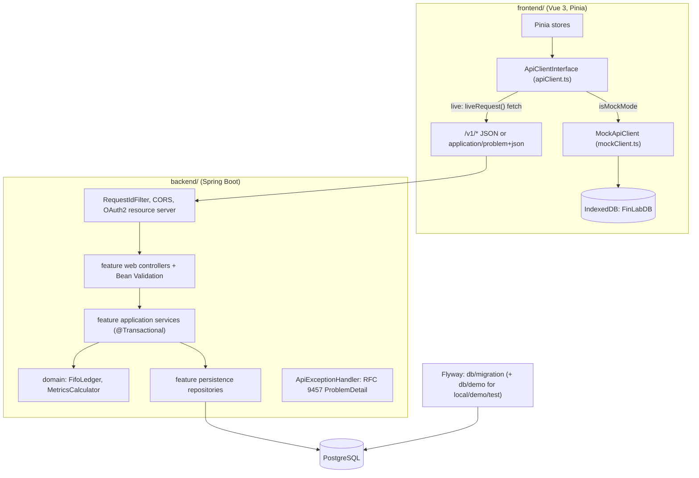

# FinLab architecture

FinLab is a Vue 3 single-page app with two interchangeable backends behind one TypeScript interface,
`ApiClientInterface` (`frontend/src/services/api/apiClient.ts`):

- **mock mode** — `MockApiClient` runs inside the browser, persists to IndexedDB through Dexie and computes holdings
  and metrics locally. The public demo (https://financial-lab-six.vercel.app) is built with `VITE_DEMO_ONLY=true`
  and always uses this mode.
- **live mode** — the same calls go over HTTP to the Spring Boot service in `backend/` (Java 21, Spring Boot 4.1.2,
  PostgreSQL, Flyway). The backend is **not hosted publicly**; it runs locally (see the
  [README](../README.md#전체-스택-로컬-실행)).

Both sides honor the same `/v1/*` contract. The shared examples in [`contract/`](../contract/README.md) are checked by
the frontend's Zod schemas and by the backend's PostgreSQL integration tests.

## Frontend

| Layer | Path | Responsibility |
|-------|------|----------------|
| Entry / startup | `frontend/src/main.ts` | Restores session and config from `localStorage`, awaits `initializeSeedData()` before mounting the router, shows a localized startup error screen if storage or seeding fails. |
| Routing | `frontend/src/app/router.ts` | Lazy-loaded routes (`/dashboard`, `/transactions`, `/goals-plans`, `/backtest`, `/api-playground`, `/docs`). Guard redirects unauthenticated users to `/login` and waits for `whenSeedReady()`. |
| Pages | `frontend/src/pages/*.vue` | UI. `BacktestLabPage` and `TransactionsPage` start workers directly. `LoginPage` sends email and a transient password. |
| State | `frontend/src/stores/*.ts` (Pinia) | `authStore`, `configStore` (backend mode, URL, locale), `portfolioStore`, `transactionStore`, `goalPlanStore`, `analyticsStore`, `toastStore`. Stores call only `apiClient`. |
| API boundary | `frontend/src/services/api/apiClient.ts` | `ApiClientInterface`; each method branches on `configStore.isMockMode`. Live calls go through `liveRequest()`. |
| API contract | `frontend/src/services/api/schemas.ts`, `contract/*.json` | Zod request/response schemas, including `ApiErrorSchema`; shared JSON examples. |
| Mock backend | `frontend/src/services/api/mockClient.ts` | Implements the contract over IndexedDB: validation, FIFO ledger checks, holdings, metrics, goals, plans, market data. |
| Persistence | `frontend/src/services/db/schema.ts`, `frontend/src/services/db/repositories/` | Dexie database `FinLabDB` with tables `users`, `portfolios`, `transactions`, `holdings`, `goals`, `plans`, `candles` (`[symbol+date]` index), `metricSnapshots`. |
| Domain logic | `frontend/src/utils/fifoCalculator.ts`, `frontend/src/utils/metrics.ts` | FIFO lot matching with `decimal.js` (buy fees in lot cost, sell fees reduce proceeds); percent-return metrics shared by the worker and the mock. |
| Seeding | `frontend/src/utils/seedLoader.ts` | Loads OHLCV CSVs and the bundled sample transactions; idempotent and non-destructive ([ADR 0003](adr/0003-idempotent-non-destructive-demo-seeding.md)). |
| Workers | `frontend/src/workers/` | DCA vs lump-sum backtest; volatility, Sharpe, max drawdown; CSV parsing with PapaParse. |

### How the mode is chosen

`configStore.backendMode` (`mock` | `live`) and `backendUrl` are stored in `localStorage` and can be changed on the
landing page or in the navigation settings panel. With `VITE_DEMO_ONLY=true` the store ignores a stored `live` value,
the settings panel shows only a hint, and `vercel.json`'s CSP restricts `connect-src` to self and Vercel, so the public
demo cannot reach any backend. The default live URL in `configStore.ts` is `http://localhost:8080`; nothing in
this repository deploys a remote backend; run the local service at that address.

### Mock mode data flow (adding a transaction)

1. `TransactionsPage` → `transactionStore` → `apiClient.createTransaction()` → `MockApiClient.createTransaction()`.
2. The request is parsed with `CreateTransactionRequestSchema`; a `ZodError` becomes `VALIDATION_ERROR`.
3. For a SELL, the existing ledger plus the new row is replayed through `calculateHoldingsFromTransactions()`; an
   oversell is rejected before any write ([ADR 0002](adr/0002-validate-fifo-ledger-before-write.md)).
4. `TransactionRepository.create()` writes to IndexedDB and the stored row is returned through the response schema.

Deletion replays the ledger without the row and refuses the delete if a later SELL would break, unless the ledger was
already broken. The backend reproduces the same rules on the server (below).

### Live mode request handling

`liveRequest()` builds `baseUrl + path`, sends `Authorization: Bearer <token>` when a token exists, a fresh
`X-Request-Id` (`crypto.randomUUID()`), and JSON bodies. Then:

| Outcome | Client result |
|---------|---------------|
| 2xx | Body (or its `data` field) parsed with the endpoint's Zod schema; mismatch → `SCHEMA_VALIDATION_FAILED`. |
| non-2xx with `Content-Type: application/problem+json` | `readProblem()` parses `{ code, message, details? }` with `ApiErrorSchema` and retains details and promotes readable field-error reasons into the displayed message. |
| non-2xx, other or unreadable body | Generic `HTTP_<status>` error; raw HTML/JSON is not shown. |
| 401 on any path except `/v1/auth/login` | `expireSession()` logs out once (shared promise) and routes to `/login?redirect=<original fullPath>`. Wrong credentials stay a login-form error. |
| `fetch` failure / empty base URL | `NETWORK_ERROR` / `BACKEND_URL_NOT_CONFIGURED`. |

Callers always receive `ApiResponse<T>`; nothing throws across the boundary. Live login validates
`LoginRequestSchema` (email, password of at most 72 UTF-8 bytes) before sending. In live mode `analyticsStore` takes metrics
from `GET /v1/metrics/portfolio/{id}`; the backtest page still reads candles from IndexedDB and runs in a worker in
both modes. Live transaction submissions send a UUID `Idempotency-Key`, retained for retries of the same submit.

## Backend

Source root: `backend/src/main/java/io/github/cskwork/finlab/`. Deeper reference:
[backend/docs/architecture.md](../backend/docs/architecture.md); operations and configuration:
[backend/README.md](../backend/README.md).

### Packages and layering

Each feature package has the same layers (`web`, `application`, `domain`, `persistence`, where needed):

| Package | Owns |
|---------|------|
| `auth` | Login (`AuthController`, `AuthService`, `LoginAttemptLimiter`), `User`, JWT properties (`auth/config`), Spring Security (`auth/security`). |
| `portfolio` | Owned portfolio aggregate with `@Version`; `PortfolioLockingRepositoryImpl` for the row lock. |
| `transaction` | Immutable ledger entries, `FifoLedger`, idempotency records and `IdempotencyPurge`, SQL list filters. |
| `holding`, `metrics` | Computed views: FIFO replay plus latest close, and percent-return statistics (`MetricsCalculator`). No stored snapshots. |
| `goal`, `plan` | Owned create/read/delete resources; plan date range validated by `@ValidPlanDates`. |
| `marketdata` | Read-only candles, batched history query for all held symbols. |
| `common/error`, `common/web` | `ApiExceptionHandler`, `Problems`, `RequestIdFilter`, `@CurrentUserId`, `ApiNumbers`, OpenAPI config. |
| `config` | Shared UTC `Clock`, plain-decimal JSON, validated `FinLabProperties`. |

`backend/src/test/java/io/github/cskwork/finlab/architecture/LayeringTest.java` enforces eight ArchUnit rules:
domain does not depend on outer layers; application does not depend on web; controllers do not bypass application
services; persistence does not depend on application or web; mutable aggregates use optimistic versioning; features use
each other only through application interfaces; feature packages have no cycles; `common` does not depend on features.

### Endpoints

18 operations, matching `apiClient.ts`: `POST /v1/auth/login`; portfolios (list, create, get, patch, delete);
transactions (`GET`/`POST /v1/portfolios/{id}/transactions`, `DELETE /v1/transactions/{id}`); holdings; metrics;
goals and plans (list, create, delete); `GET /v1/market-data`. Creates return 201, deletes return 200 with
`{"success":true}` because the client always reads a JSON body. The full table is in
[contract/README.md](../contract/README.md). springdoc serves `/v3/api-docs` and `/swagger-ui.html`.

### Transactions and locking

`spring.jpa.open-in-view=false`, so database work happens only inside application-service transactions.
A transaction create or delete in `TransactionService`:

1. Locks the owned portfolio with `PortfolioRepository.lockOwned()` — `PESSIMISTIC_WRITE` (`SELECT … FOR UPDATE`).
   `PortfolioLockingRepositoryImpl` first runs `set_config('lock_timeout', …, true)` and also sets the JPA lock hint,
   both from `finlab.ledger.lock-timeout-ms` (default 3000).
2. Checks the optional idempotency key under that lock.
3. Reads the complete ledger ordered by timestamp and ID, applies the change, and replays `FifoLedger`
   (`BigDecimal`, `DECIMAL128` division).
4. Oversell, or deleting a BUY a later SELL needs → 422 `VALIDATION_ERROR`. Lock timeout or optimistic-lock
   failures → 409 `CONCURRENT_MODIFICATION`; integrity failures → 409 `DATA_INTEGRITY`. Otherwise the ledger write and idempotency record commit together.

Writes to one portfolio serialize; different portfolios lock different rows. The list endpoint applies date/type/symbol
filters in SQL and returns the newest `finlab.ledger.transaction-list-limit` rows (default 1000), ordered by timestamp/ID descending with an exposed `X-Total-Count` header for all filtered matches; validation and valuation
use a separate complete-ledger query. Why a pessimistic lock rather than optimistic versioning:
[backend ADR 0001](../backend/docs/adr/0001-ledger-consistency.md).

### Idempotency

`POST /v1/portfolios/{id}/transactions` accepts `Idempotency-Key` (1–128 visible ASCII characters). The record is
unique per `(portfolio_id, idempotency_key)` and stores a SHA-256 fingerprint of the normalized request plus the JSON
response. `IdempotencyPolicy.evaluate()` returns `REPLAY` (same request, not expired → stored response),
`MISMATCH` (different body → 422 `IDEMPOTENCY_KEY_REUSED`) or `EXPIRED` (row deleted, request processed). TTL
`finlab.idempotency.ttl` defaults to 24h; `IdempotencyPurge` deletes expired rows every `purge-interval` (1h) using
the indexed `expires_at` column. The smoke transcript shows a byte-identical replay and a 422 for a changed body.

### Errors

`ApiExceptionHandler` extends Spring's `ResponseEntityExceptionHandler`, so framework errors keep their status and
headers, and every error becomes an RFC 9457 `ProblemDetail` with `code`, `message`, `requestId`, and for field
validation `details.fieldErrors`. Application problems built by `Problems.create()` use `type: urn:finlab:problem:<code>`.

| Status | Code examples | Cause |
|--------|---------------|-------|
| 400 | `VALIDATION_ERROR` | Bean Validation, malformed body, path/body ID mismatch, bad idempotency key |
| 401 | `UNAUTHORIZED`, `INVALID_CREDENTIALS` | Missing or invalid token / wrong login (one generic response) |
| 403 | `FORBIDDEN` | Valid token without `USER` or `ADMIN` |
| 404 | `NOT_FOUND` | Missing **or foreign** resource (same response, so existence is not revealed) |
| 409 | `CONCURRENT_MODIFICATION`, `DATA_INTEGRITY` | Lock timeout/optimistic lock, or a database integrity conflict (logged at WARN with its cause) |
| 422 | `VALIDATION_ERROR`, `IDEMPOTENCY_KEY_REUSED` | FIFO ledger rule, idempotency mismatch |
| 429 / 503 | `AUTHENTICATION_RATE_LIMITED` / `AUTHENTICATION_BUSY` | Login rate bucket exhausted / hashing semaphore full; both send `Retry-After` |
| 500 | `INTERNAL_ERROR` | Unexpected; logged server-side, no message or stack trace in the body |

The five `contract/error-*.json` examples pin 400, 401, 403, 404 and 422 bodies.

### Security

- **Login** — `AuthService` lowercases and trims the email (unique index on `lower(email)`, migration V4), verifies with
  `DelegatingPasswordEncoder` / bcrypt cost 12, and performs a dummy hash for unknown accounts. The repository read
  transaction ends before hashing. A semaphore (`hashing-permits`, default 2) waits up to `hashing-wait` (default 500 ms) for capacity, then returns 503.
- **Login limiter** — `LoginAttemptLimiter` keeps token buckets per peer IP (20) and per email (10), refilling over
  1 minute, tracking at most 10000 keys. In-memory, per process. `server.forward-headers-strategy: none`, so a
  submitted `X-Forwarded-For` is ignored.
- **Tokens** — RS256, issuer `finlab`, audience `finlab-api`, TTL 15m (validated ≤ 1h). The OAuth2 resource server
  validates signature, issuer, audience, expiry and a numeric subject. Controllers get the user through
  `@CurrentUserId`. `local`/`test` profiles generate an ephemeral key pair if none is configured; every other profile
  requires PEM key resources (≥ 2048 bits). Decision record: [backend ADR 0002](../backend/docs/adr/0002-auth-contract.md).
- **HTTP** — stateless sessions, CSRF disabled for the bearer API, CORS allowlist (default `http://localhost:5173`),
  strict CSP on API paths; only Swagger paths allow inline styles and data images.

### Observability

`RequestIdFilter` accepts an incoming `X-Request-Id` matching `[A-Za-z0-9._-]{1,128}` or generates a UUID, returns it in
the response header, puts it in MDC and in problem bodies. Console logs use Spring Boot's ECS JSON format. Actuator
exposes only `health` (details hidden) and `info`. Virtual threads are enabled; graceful shutdown allows 30s per phase.
There are no custom metrics or tracing exporters.

### Configuration

All defaults are in `backend/src/main/resources/application.yml` with environment overrides (`DB_URL`, `PORT`,
`CORS_ALLOWED_ORIGINS`, `FINLAB_JWT_*`, `FINLAB_LOGIN_*`). `config/FinLabProperties.java` is a validated
`@ConfigurationProperties("finlab")` record; invalid values stop startup:

| Group | Properties (default) |
|-------|----------------------|
| `cors` | `allowed-origins` — non-empty explicit HTTP(S) origins |
| `idempotency` | `ttl` (24h), `purge-interval` (1h) — both positive |
| `login` | `hashing-permits` (2, 1–64), `hashing-wait` (500ms, >0 and ≤5s), `ip-capacity` (20), `email-capacity` (10), `refill-period` (1m), `max-tracked-keys` (10000) |
| `ledger` | `lock-timeout-ms` (3000, 1–60000), `transaction-list-limit` (1000, 1–10000) |

JWT settings live separately in `auth/config/JwtProperties.java`. Services take time from the shared UTC `Clock` bean.

### Migrations and profiles

Flyway owns the schema; Hibernate runs with `ddl-auto: validate`.

| Migration | Location | Applied in |
|-----------|----------|------------|
| `V1__create_finlab_schema.sql` — users, portfolios, transactions, idempotency records, goals, plans, candles; `NUMERIC(19,4)` money, `NUMERIC(20,8)` quantities, `TIMESTAMPTZ` | `db/migration` | all profiles |
| `V2__seed_demo_user.sql` — public demo account `demo@finlab.app` (bcrypt hash) | `db/demo` | only `local`, `demo`, `test` |
| `V3__seed_sample_market_data.sql` — bundled OHLCV samples, generated from `frontend/public/data/ohlcv/*.csv` by `backend/scripts/generate-market-data.py` | `db/migration` | all profiles |
| `V4__case_insensitive_email_and_immutable_resources.sql` — `UNIQUE(lower(email))`, drops goal/plan versions | `db/migration` | all profiles |

| Profile | Purpose |
|---------|---------|
| (default) | Production-shaped: no demo account, signing keys required. |
| `local` | Local PostgreSQL (`localhost:5432/finlab` unless `DB_URL`), demo account, ephemeral keys allowed. |
| `demo` | Adds the demo account only; keys still required. |
| `test` | Demo account, ephemeral keys, high login limits for tests. |

Responses round only at the HTTP boundary (`ApiNumbers`, `HALF_UP`): money to 4 decimals, quantity and average cost to 8.
Internal FIFO and metric calculations keep full precision.

## Testing and verification

| Suite | Where | Notes |
|-------|-------|-------|
| Frontend unit (183 tests, 17 files) | `frontend/src/**/*.spec.ts`, Vitest + happy-dom + fake-indexeddb | Includes `contract.spec.ts` and `apiClient.spec.ts` (problem parsing, 401 expiry). |
| Backend (225 tests) | `backend/src/test/java/...` | Domain, application, MVC slices, ArchUnit, persistence, integration. |
| Integration | `integration/ApiIntegrationTest.java` | Starts Zonky embedded PostgreSQL 14.22 binaries (no Docker) on a random port; Flyway, login, owned CRUD, concurrent sells, idempotent replay and expiry, lock timeout → 409. Writes 18 actual response bodies to `backend/target/contract-actual/`. |
| Coverage gate | `backend/pom.xml` (JaCoCo 0.8.14) | `verify` fails if any `*.application` or `*.domain` package is below 80% line coverage. |
| HTTP smoke | `backend/scripts/smoke.sh` | curl against a running server; transcript in `backend/docs/smoke-2026-10-28.txt`. |

Results dated 2026-10-28 are in the [README](../README.md#테스트) and
[backend/docs/verification-2026-10-28.md](../backend/docs/verification-2026-10-28.md). CI (`.github/workflows/ci.yml`)
runs the frontend job and a backend job (`./mvnw -B verify`, then the frontend contract spec against the captured
backend responses).

## Verified demo figure changes (2026-10-28)

Inputs are the bundled transactions and full 2024-01-02–2024-04-01 price range. Regression tests assert the
fee-inclusive holdings, realized sales, SPY DCA and corrected Sharpe (`fifoCalculator.spec.ts`,
`backtestWorker.spec.ts`, `metrics.spec.ts`); the backend's `FifoLedgerTest` and metrics tests pin the same
reference values (average cost 195.0394444444, Sharpe 5.4106641762). Old figures were recomputed with fees omitted,
the decimal risk-free subtraction, and 30-row monthly stepping respectively.

| Calculation | Before | After |
|-------------|--------|-------|
| AAPL average FIFO cost (90 shares) | $194.981111 | $195.039444 |
| SPY average FIFO cost (25 shares) | $480.56 | $480.63 |
| AAPL / SPY unrealized PnL at last close | $1,628 / $740 | $1,622.75 / $738.25 |
| Total unrealized PnL | $2,368 | $2,361 |
| AAPL / SPY realized PnL in calculator (not dashboard) | $233.40 / $315.30 | $231.15 / $313.55 |
| Portfolio annualized Sharpe (default 2% annual risk-free) | 5.654311 | 5.410664 |
| SPY monthly DCA, $100 per purchase: count / invested / final value | 3 / $300 / $312.55 | 4 / $400 / $416.31 |

SPY DCA now buys January 2, February 1, March 1 and April 1. The changed DCA final value includes an extra $100
contribution; it is not a like-for-like performance gain.

## External dependencies

- Frontend runtime (`frontend/package.json`): Vue 3, Vue Router 4, Pinia 3, vue-i18n 9, Dexie 4, Zod 4, decimal.js,
  PapaParse, Chart.js 4. Test: Vitest 4, happy-dom 21, fake-indexeddb.
- Backend (`backend/pom.xml`): Spring Boot 4.1.2 starters (webmvc, security, oauth2-resource-server, data-jpa,
  validation, flyway, actuator), PostgreSQL JDBC, springdoc 3.2.0. Test: Zonky embedded-postgres 2.2.2, ArchUnit 1.5.1.
  Maven Wrapper pins Maven 3.9.16.
- Hosting: Vercel for the static demo (`vercel.json`); a GitHub Pages workflow also exists
  (`.github/workflows/deploy.yml`). No backend hosting is configured.

## Failure handling (frontend)

| Failure | Handling | Where |
|---------|----------|-------|
| `localStorage` unreadable at startup | Localized startup error screen; app is not mounted. | `main.ts` |
| Seeding fails | Logged and startup error screen shown. | `main.ts`, `seedLoader.ts` |
| Invalid request data (mock) | Zod → `VALIDATION_ERROR` with flattened details. | `mockClient.ts` |
| Oversell / dependent delete (mock) | Rejected before write with `VALIDATION_ERROR`. | `mockClient.ts` |
| Live problem response | `ApiErrorSchema` fields preserved; others → `HTTP_<status>`. | `apiClient.ts` |
| Live 401 on protected call | Session cleared, redirect to `/login?redirect=<original fullPath>`. | `apiClient.ts` |
| Live network / schema errors | `NETWORK_ERROR`, `SCHEMA_VALIDATION_FAILED`. | `apiClient.ts` |
| Worker computation error | Worker posts `{ type: 'error' }`; caller rejects and terminates the worker. | `workers/*.ts` |
| Component render error | `ErrorBoundary` component. | `components/layout/ErrorBoundary.vue` |

Backend failure handling is the [Errors](#errors) table above.

## Limitations

- The public demo is mock-only; the backend is not deployed anywhere.
- Prices are bundled 2024-01-02–2024-04-01 samples for five symbols, not a live feed.
- No refresh tokens, revocation, registration or password recovery; the frontend keeps the token in `localStorage`.
- The login limiter and hashing semaphore are per process; several instances need a shared or edge limiter.
- Ledger writes in one portfolio serialize and replay the whole ledger (linear in its length); transaction lists stop at
  1000 rows without a cursor; other collections are unpaginated.
- Metrics keep the mock's semantics: latest market-value weights, `cash = 0`, `pnlYTD` compounds all sampled history.
- Backtests run only in the browser on IndexedDB samples and model no fees or slippage.
- FIFO and metrics rules exist twice (TypeScript mock and Java backend). Contract fixtures check shapes; matching values
  rely on both test suites pinning the same reference numbers.
- Pre-backend design documents are kept in [planned/](planned/) with superseded banners.
